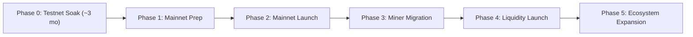

# Armaxcoin Treasury & Testnet Miner Migration Plan

**Version:** 1.1  
**Date:** November 12, 2026  
**Status:** DRAFT FOR EVALUATION AND APPROVAL (Non-binding, Not Final)  
**Scope:** Mainnet Treasury Planning, Testnet Miner Migration, Liquidity Allocation, and Ecosystem Development  
**Document Type:** Strategic Policy Proposal (Not an implementation and not an authorization of execution)  

> [!IMPORTANT]
> **CRITICAL DISCLAIMER:**  
> This document is a strategic draft subject to change. Testnet coins (`tARMX`) possess **zero monetary value**, no market price, and no promise or guarantee of conversion, trading, or monetary worth. This document is **not an investment offer, not a promise of financial return, and not financial advice**. All figures, conversion ratios, and execution schedules become effective only upon formal governance ratification and official public announcement.

---

## Table of Contents
1. [Objective](#1-objective)
2. [Treasury Allocation Summary](#2-treasury-allocation-summary)
3. [Testnet Miner Migration (300,000 ARMX)](#3-testnet-miner-migration--300000-armx)
4. [Liquidity Reserve (200,000 ARMX)](#4-liquidity-reserve--200000-armx)
5. [Ecosystem Development (100,000 ARMX)](#5-ecosystem-development--100000-armx)
6. [Community & Adoption (100,000 ARMX)](#6-community--adoption--100000-armx)
7. [Operations & Infrastructure (50,000 ARMX)](#7-operations--infrastructure--50000-armx)
8. [Strategic Native Reserve (250,000 ARMX)](#8-strategic-native-reserve--250000-armx)
9. [Wallet Structure & Custody Controls](#9-wallet-structure--custody-controls)
10. [Governance & Transparency Standards](#10-governance--transparency-standards)
11. [Implementation Roadmap](#11-implementation-roadmap)
12. [Key Risks & Mitigations](#12-key-risks--mitigations)
13. [Verification Checklist](#13-verification-checklist)
14. [Simulation Based on Current Figures](#14-simulation-based-on-current-figures)
15. [Decision Boundaries & Scope Invariants](#15-decision-boundaries--scope-invariants)
16. [Conclusion](#16-conclusion)

---

## 1. Objective

This document establishes the preliminary framework for managing the planned **1,000,000 ARMX** project treasury. These coins are planned to be obtained strictly through mining under Layer-1 consensus rules and legally owned by or remitted to the project treasury.

**Primary Objectives:**
1. Acknowledge and reward the contributions of community miners during the public Testnet phase.
2. Establish a structured mechanism to migrate verified Testnet mining rewards to Mainnet.
3. Provide dedicated reserves for trading liquidity and ecosystem development.
4. Maintain a strategic native ARMX reserve for long-term network security and sustainability.
5. Implement transparent governance, multi-party custody, and verifiable accounting.

> [!NOTE]
> **Consensus Invariant:** The 1,000,000 ARMX figure represents a planned treasury target, **not an additional emission outside consensus rules**. All coins must be legitimately mined under Mainnet consensus rules and held in legal ownership. Block rewards belonging to independent community miners shall never be diverted to the treasury.

---

## 2. Treasury Allocation Summary

**Total Planned Treasury Allocation:** `1,000,000 ARMX` (~0.7937% of the 126,000,000 ARMX maximum supply).

| Sector | Allocation | Percentage | Primary Purpose |
|---|---:|---:|---|
| **Testnet Miner Migration** | 300,000 ARMX | 30.0% | Rewarding verified testnet mining participation |
| **Liquidity Reserve** | 200,000 ARMX | 20.0% | Exchange pairs, AMM pools, and market depth |
| **Ecosystem Development** | 100,000 ARMX | 10.0% | Tooling, bridges, explorers, and developer grants |
| **Community & Adoption** | 100,000 ARMX | 10.0% | User campaigns, education, and community initiatives |
| **Operations & Infrastructure** | 50,000 ARMX | 5.0% | Seed nodes, RPC servers, audits, and security response |
| **Strategic Native Reserve** | 250,000 ARMX | 25.0% | Long-term unencumbered network reserve |
| **Total** | **1,000,000 ARMX** | **100.0%** | **Comprehensive Treasury Plan** |

*Revision Note (v1.1):* The Testnet Miner Migration allocation was increased from 150,000 to 300,000 ARMX. To maintain the exact 1,000,000 ARMX total cap, the Strategic Native Reserve was adjusted from 400,000 to 250,000 ARMX. All other sector allocations remain unchanged.

---

## 3. Testnet Miner Migration — 300,000 ARMX

### 3.1 Purpose
This program honors miners who dedicated computational resources to testing, securing, and stabilizing the Armaxcoin testnet (`ARMX-TESTNET-1`). This program does not imply that `tARMX` has monetary value or represents an investment contract.

### 3.2 Candidate Conversion Ratio
The proposed ratio under evaluation is **10 tARMX : 1 ARMX**.

| Testnet Reward (tARMX) | Mainnet Allocation (ARMX) |
|---:|---:|
| 1,000 tARMX | 100 ARMX |
| 10,000 tARMX | 1,000 ARMX |
| 100,000 tARMX | 10,000 ARMX |
| 1,000,000 tARMX | 100,000 ARMX |

*Note:* This ratio is a proposal subject to final data reconciliation and community governance approval.

### 3.3 Testnet Baseline at Drafting
- Total testnet coins generated at drafting date: `~868,260 tARMX`.
- Testnet planned operational window: Approximately 3 additional months.
- Candidate conversion ratio: `10:1`.
- Maximum migration budget cap: `300,000 ARMX`.
- *Simulation:* If the entire 868,260 tARMX were confirmed as eligible mining rewards, conversion would yield:
  $$868,260 \div 10 = 86,826\text{ ARMX}$$
  This is a mathematical simulation only. Total circulating supply on testnet does not automatically equal eligible mining rewards; full historical block reconciliation is required.

### 3.4 Budget Capacity
At the candidate 10:1 ratio, the 300,000 ARMX budget mathematically accommodates up to **3,000,000 eligible tARMX**.
The 300,000 ARMX allocation represents a strict maximum ceiling, not a mandatory spending quota. Unclaimed or surplus funds remain in the treasury under formal governance. If eligible claims exceed 300,000 ARMX, the ratio shall not be silently lowered nor funds seized from other sectors without formal public review.

### 3.5 Three-Month Testnet Soak Window
For approximately 3 months following the publication of this plan:
1. The testnet continues open operation for mining and consensus validation.
2. Complete block history, coinbase records, pool payouts, and reorg history are immutably archived.
3. No final conversion or snapshot occurs until the soak period and verification gates conclude.
4. Final snapshot block height and timestamp will be announced publicly in advance.

### 3.6 Reward Eligibility Principles
**Potentially Eligible (Subject to Verification):**
- Valid solo mining coinbase rewards recorded on the canonical blockchain.
- Mining pool rewards substantiated by pool payout logs reconciled against on-chain pool coinbase receipts.
- Blocks that remain on the canonical heaviest chain after reorganization settlement.

**Ineligible:**
- Faucet distributions and non-mining faucet balances.
- Secondary user-to-user transfers not traceable to verified mining coinbase outputs.
- Orphaned blocks or invalid reorganizations.
- Internal developer or operator allocations not meeting external mining criteria.

*Accounting Note:* Calculation is based on cumulative earned eligible coinbase/pool rewards, not static unspent wallet balances at snapshot time (since miners legitimately transfer or spend rewards). For mining pools, payouts are reconciled to eliminate double-counting between the pool address coinbase and subsequent distribution txs.

### 3.7 Snapshot and Claim Execution Flow
1. **Data Export:** Secure complete blockchain state and pool audit logs.
2. **Snapshot Height:** Publish precise block height and UTC timestamp cutoff.
3. **Reconciliation:** Audit canonical blocks, identify verified miner addresses, and exclude duplicates.
4. **Allocation Registry:** Publish a transparent, verifiable allocation registry preserving necessary user privacy.
5. **Address Registration:** Participants sign a challenge with their testnet key and provide a valid Mainnet Bech32 recipient address (`armx1...`).
6. **Distribution:** Mainnet ARMX is disbursed from the dedicated migration treasury wallet (`treasury_migration`).

---

## 4. Liquidity Reserve — 200,000 ARMX

**Objective:** Provision decentralized trading liquidity once Mainnet, the token bridge, and wrapped asset contracts are audited and operational.

| Allocation Segment | Budget | Purpose |
|---|---:|---|
| **Initial Liquidity** | 50,000 ARMX | Initial automated market maker (AMM) pairing |
| **Liquidity Expansion** | 100,000 ARMX | Secondary pairs and depth expansion |
| **Liquidity Contingency** | 50,000 ARMX | Slippage buffers and reserve backstop |
| **Total** | **200,000 ARMX** | **Trading Liquidity Framework** |

### Guidelines & Bridge Requirements:
- This budget represents the native ARMX component; paired assets (e.g. USDT) must be independently provisioned based on market pricing.
- Initial liquidity is not deployed on Day 1 of Mainnet; deployment occurs incrementally based on market demand and network maturity.
- If ARMX is represented on EVM networks (e.g., as Wrapped ARMX / `wARMX`):
  - Native ARMX must be securely locked into audited custody before any wrapped token is minted.
  - Total circulating wrapped tokens must never exceed provable locked native reserves.
  - Bridge contracts must complete independent third-party audits before handling production value.
  - The liquidity reserve is distinct from bridge backing collateral; LP tokens and bridge collateral must be accounted for separately.

---

## 5. Ecosystem Development — 100,000 ARMX

| Sector | Allocation | Focus Area |
|---|---:|---|
| **Bridge & Cross-Chain Integration** | 25,000 ARMX | EVM relayer, proof-of-lock contracts, and multisig bridge |
| **Wallet & Client Applications** | 20,000 ARMX | Mobile wallets (Android/iOS), desktop GUI, and hardware support |
| **Explorer & Developer APIs** | 15,000 ARMX | High-availability indexers, GraphQL APIs, and web explorers |
| **Security Audits & Bounties** | 25,000 ARMX | Third-party cryptographic audits and vulnerability bounties |
| **Developer Grants** | 15,000 ARMX | Open-source ecosystem tooling and community integrations |
| **Total** | **100,000 ARMX** | **Sustainable Development** |

Grant disbursements must be milestone-based and tied to verifiable deliverables, with no 100% upfront payments.

---

## 6. Community & Adoption — 100,000 ARMX

| Sector | Allocation | Purpose |
|---|---:|---|
| **Community Contributor Rewards** | 30,000 ARMX | Recognizing non-mining community technical contributions |
| **Mining Campaigns & Competitions** | 20,000 ARMX | Hashrate decentralization and node onboarding incentives |
| **Exchange & Ecosystem Tooling** | 25,000 ARMX | Technical integration support with third-party platforms |
| **Education & Technical Docs** | 10,000 ARMX | Tutorials, translation, and academic documentation |
| **Strategic Partnerships** | 15,000 ARMX | Synergistic integrations with privacy and PQC projects |
| **Total** | **100,000 ARMX** | **Broad Community Participation** |

*Explicit Boundary:* This budget shall not be used for market price manipulation, wash trading, or speculative hype. All initiatives require clear metrics and public reporting.

---

## 7. Operations & Infrastructure — 50,000 ARMX

| Sector | Allocation | Description |
|---|---:|---|
| **Seed Nodes & VPS Infrastructure** | 15,000 ARMX | Operating geographically distributed public seed nodes |
| **Telemetry & State Backup** | 10,000 ARMX | Continuous chain monitoring, archive nodes, and logging |
| **Domain & Critical Infrastructure** | 5,000 ARMX | DNS seeds, TLS certs, and web hosting |
| **Security Incident Response** | 10,000 ARMX | Emergency response, hotfix deployment, and patching |
| **Operational Contingency** | 10,000 ARMX | Unforeseen operational expenses |
| **Total** | **50,000 ARMX** | **Reliable Infrastructure** |

---

## 8. Strategic Native Reserve — 250,000 ARMX

The Strategic Native Reserve serves as a long-term unencumbered balance sheet asset to support network resilience.

**Strict Usage Boundaries:**
- Prohibited from automated market intervention or price pegging.
- Prohibited from covering routine operational deficits without governance review.
- Prohibited from proprietary trading or speculative deployments.
- Re-allocation requires documented multi-party governance consent.

---

## 9. Wallet Structure & Custody Controls

### Proposed Wallet Segregation
To ensure transparency and prevent cross-sector leakage, treasury funds will be held in separate, labeled on-chain accounts:

| Conceptual Wallet Identifier | Allocation Cap | Description |
|---|---:|---|
| `treasury_migration` | 300,000 ARMX | Testnet miner distribution account |
| `treasury_liquidity` | 200,000 ARMX | DEX / AMM liquidity reserve |
| `treasury_ecosystem` | 100,000 ARMX | Developer grants and audits |
| `treasury_community` | 100,000 ARMX | Community programs and education |
| `treasury_operations` | 50,000 ARMX | Infrastructure and server hosting |
| `treasury_reserve` | 250,000 ARMX | Strategic long-term reserve |
| **Total** | **1,000,000 ARMX** | **Full Treasury Isolation** |

### Custody & Security Policy:
1. **Cold Storage:** Long-term reserves must be held in offline cold storage.
2. **No Server Storage:** Treasury private keys shall never reside on public seed nodes, pool servers, or explorer hosts.
3. **Multi-Party Authorization:** Large disbursements require multi-signature or multi-party approval workflows.
4. **Separation of Duties:** Proposal, review, and transaction broadcast roles must be held by distinct individuals.

---

## 10. Governance & Transparency Standards

1. **Accounting Reports:** The project will publish periodic treasury reports (at least monthly once operational).
2. **Public Disclosure:** Reports will disclose beginning balance, mined inflows, disbursements by category, transaction hashes, and remaining balances.
3. **Anti-Retroactivity:** Approved participant entitlements cannot be retroactively diminished by subsequent policy changes.
4. **Independent Reconciliation:** Audits of migration data will be conducted independently of distribution signatories.

---

## 11. Implementation Roadmap

- **Phase 0 — Testnet Soak (Current):** Continue public testnet operation for approximately 3 months. Maintain immutable block and pool logs. Finalize eligibility specifications. No mainnet distributions or consensus changes occur during this phase.
- **Phase 1 — Mainnet Preparation:** Complete formal security audits of consensus, node, and wallet. Finalize treasury custody policies. Reconcile testnet mining records.
- **Phase 2 — Mainnet Launch:** Mainnet launches under verified consensus rules. Treasury begins receiving legitimate mined rewards up to the policy cap.
- **Phase 3 — Testnet Miner Migration:** Announce snapshot cutoff. Reconcile solo and pool rewards. Open Mainnet address registration. Disburse migration allocations from `treasury_migration`.
- **Phase 4 — Liquidity Launch:** Audit bridge and token contracts. Provision initial AMM liquidity gradually.
- **Phase 5 — Ecosystem Expansion:** Activate developer grants, explorer enhancements, and community programs.

---

## 12. Key Risks & Mitigations

| Risk Description | Severity | Mitigation Strategy |
|---|:---:|---|
| Circulating testnet supply confused with eligible rewards | High | Strict reconciliation of canonical block coinbase transactions |
| Double-counting pool coinbase and individual miner shares | High | Reconcile pool coinbase inputs against external pool payout ledgers |
| Reorganization or invalid block inclusion | Medium | Evaluate solely canonical longest chain after maturity finality |
| Sybil / duplicate claims | Medium | Unique claim identifier, cryptographic signature challenge, and public registry |
| Valid claims exceed 300,000 ARMX budget | Medium | Halt finalization; submit to governance review without retroactive ratio cuts |
| Bridge security exploits | Critical | Independent third-party smart contract audits and strict rate limits |
| Impermanent loss or liquidity drain | High | Phased deployment with continuous depth and volatility monitoring |
| Treasury mismanagement | Critical | Segregated sector wallets, cold storage, multi-party approvals, and public ledger |

---

## 13. Verification Checklist

Before formal ratification and snapshot execution, the following data points must be verified:
- [ ] Confirm exact testnet emission and circulating supply breakdown at snapshot.
- [ ] Complete canonical block history export and reconciliation.
- [ ] Secure verified pool operator payout databases for all active testnet pools.
- [ ] Exclude all faucet, test transfer, and reorganized block balances.
- [ ] Estimate final projected testnet block height and mining reward volume over the remaining 3-month window.
- [ ] Finalize secure custody infrastructure for the 1,000,000 ARMX Mainnet treasury.
- [ ] Confirm pairing asset arrangements (e.g. USDT) for initial liquidity deployment.

---

## 14. Simulation Based on Current Figures

| Metric | Current Estimate | Notes |
|---|---:|---|
| Current Testnet Coin Generation | ~868,260 tARMX | Subject to final reconciliation |
| Proposed Ratio | 10 : 1 | 10 tARMX converts to 1 ARMX |
| Theoretical Conversion (Current) | ~86,826 ARMX | Assuming 100% eligibility |
| Maximum Program Allocation | 300,000 ARMX | Strict ceiling |
| Program tARMX Capacity at 10:1 | 3,000,000 tARMX | Accommodates 3x current volume |
| Remaining Testnet Duration | ~3 Months | Allows continued testing and hashrate soaking |

*Note:* Future production over the upcoming 3 months will vary depending on network hashrate, active miners, and difficulty dynamics. Accurate figures will be published prior to snapshot height.

---

## 15. Decision Boundaries & Scope Invariants

This document is a strategic draft. **It does not authorize or execute:**
- Any change to the 126,000,000 ARMX total supply cap.
- Any alteration to Mainnet halving cadence (1,050,000 blocks) or initial reward (60 ARMX).
- Any modification to genesis parameters, target block time (120s), or consensus rules.
- Any unlock of Mainnet prior to formal readiness authorization (`core.MainnetLaunched = false`).
- Any premature token sale, distribution, or speculative listing.

---

## 16. Conclusion

Armaxcoin proposes a structured 1,000,000 ARMX treasury plan designed to balance testnet miner recognition, market liquidity, developer tooling, operational stability, and long-term network reserves.

The 300,000 ARMX migration allocation accommodates up to 3,000,000 eligible tARMX at the proposed 10:1 ratio, providing ample capacity as the testnet continues its ~3-month soaking period.

**Guiding Principles:** Honor community contributors, preserve consensus immutability, maintain transparent accounting, and protect mainnet integrity above market haste.
