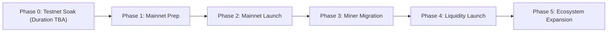

# Armaxcoin Treasury & Testnet Miner Migration Plan

**Version:** 1.2 (Preliminary Non-Final Plan)  
**Date:** November 16, 2026  
**Status:** PRELIMINARY PLAN — NOT FINAL (Non-binding Draft for Evaluation and Approval)  
**Scope:** Mainnet Treasury Planning, Testnet Miner Migration, Liquidity Allocation, and Ecosystem Development  
**Document Type:** Preliminary Non-Final Strategic Policy Plan (Subject to Ongoing Evaluation; Not an Implementation and Not an Authorization of Execution)  

> [!IMPORTANT]
> **CRITICAL DISCLAIMER (PRELIMINARY NON-FINAL PLAN):**  
> This document is a **preliminary, non-final strategic plan** subject to revision, ongoing evaluation, and formal governance ratification. The public testnet operational timeline is **open-ended (`TBA` / undetermined)** and depends on the completion of all Mainnet readiness gates and open independent security reviews in [`docs/MAINNET_READINESS.md`](../MAINNET_READINESS.md). Testnet coins (`tARMX`) currently have **no market price or liquidity**; while eligible verified community mining rewards are intended for future Mainnet migration under this plan, the final conversion ratio and terms remain non-final (`TBA`) and subject to formal governance ratification. This document is **not an investment offer, not a promise of financial return, and not financial advice**. All figures, exclusion lists, conversion ratios, and execution schedules become effective only upon formal governance ratification and official public announcement.

---

## Table of Contents
1. [Objective](#1-objective)
2. [Treasury Allocation Summary](#2-treasury-allocation-summary)
3. [Testnet Miner Migration (300,000 ARMX)](#3-testnet-miner-migration--300000-armx)
4. [Liquidity Reserve (200,000 ARMX)](#4-liquidity-reserve--200000-armx)
5. [Ecosystem Development (100,000 ARMX)](#5-ecosystem-development--100000-armx)
6. [Community & Adoption (100,000 ARMX)](#6-community--adoption--100000-armx)
7. [Operations & Infrastructure (50,000 ARMX)](#7-operations--infrastructure--50000-armx)
8. [Strategic Native Reserve (250,000 ARMX)](#8-strategic-native-reserve--250000-armx)
9. [Wallet Structure & Custody Controls](#9-wallet-structure--custody-controls)
10. [Governance & Transparency Standards](#10-governance--transparency-standards)
11. [Implementation Roadmap](#11-implementation-roadmap)
12. [Key Risks & Mitigations](#12-key-risks--mitigations)
13. [Verification Checklist](#13-verification-checklist)
14. [Simulation Based on Current Figures](#14-simulation-based-on-current-figures)
15. [Decision Boundaries & Scope Invariants](#15-decision-boundaries--scope-invariants)
16. [Conclusion](#16-conclusion)

---

## 1. Objective

This document establishes the preliminary framework for managing the planned **1,000,000 ARMX** project treasury. These coins are planned to be obtained strictly through mining under Layer-1 consensus rules and legally owned by or remitted to the project treasury.

**Primary Objectives:**
1. Acknowledge and reward the contributions of community miners during the public Testnet phase.
2. Establish a structured mechanism to migrate verified Testnet mining rewards to Mainnet.
3. Provide dedicated reserves for trading liquidity and ecosystem development.
4. Maintain a strategic native ARMX reserve for long-term network security and sustainability.
5. Implement transparent governance, multi-party custody, and verifiable accounting.

> [!NOTE]
> **Consensus Invariant:** The 1,000,000 ARMX figure represents a planned treasury target, **not an additional emission outside consensus rules**. All coins must be legitimately mined under Mainnet consensus rules and held in legal ownership. Block rewards belonging to independent community miners shall never be diverted to the treasury.

---

## 2. Treasury Allocation Summary

**Total Planned Treasury Allocation:** `1,000,000 ARMX` (~0.7937% of the 126,000,000 ARMX maximum supply).

| Sector | Allocation | Percentage | Primary Purpose |
|---|---:|---:|---|
| **Testnet Miner Migration** | 300,000 ARMX | 30.0% | Rewarding verified testnet mining participation |
| **Liquidity Reserve** | 200,000 ARMX | 20.0% | Exchange pairs, AMM pools, and market depth |
| **Ecosystem Development** | 100,000 ARMX | 10.0% | Tooling, bridges, explorers, and developer grants |
| **Community & Adoption** | 100,000 ARMX | 10.0% | User campaigns, education, and community initiatives |
| **Operations & Infrastructure** | 50,000 ARMX | 5.0% | Seed nodes, RPC servers, audits, and security response |
| **Strategic Native Reserve** | 250,000 ARMX | 25.0% | Long-term unencumbered network reserve |
| **Total** | **1,000,000 ARMX** | **100.0%** | **Comprehensive Treasury Plan** |

*Revision Note (v1.1):* The Testnet Miner Migration allocation was increased from 150,000 to 300,000 ARMX. To maintain the exact 1,000,000 ARMX total cap, the Strategic Native Reserve was adjusted from 400,000 to 250,000 ARMX. All other sector allocations remain unchanged.

---

## 3. Testnet Miner Migration — 300,000 ARMX

### 3.1 Purpose
This program honors miners who dedicated computational resources to testing, securing, and stabilizing the Armaxcoin testnet (`ARMX-TESTNET-1`). While verified mining rewards are planned to be convertible to Mainnet ARMX at a future non-final ratio (`TBA`), `tARMX` has no current market value and this plan does not constitute an investment contract.

### 3.2 Candidate Conversion Ratio
The proposed ratio under evaluation is **10 tARMX : 1 ARMX**.

| Testnet Reward (tARMX) | Mainnet Allocation (ARMX) |
|---:|---:|
| 1,000 tARMX | 100 ARMX |
| 10,000 tARMX | 1,000 ARMX |
| 100,000 tARMX | 10,000 ARMX |
| 1,000,000 tARMX | 100,000 ARMX |

*Note:* This ratio is a proposal subject to final data reconciliation and community governance approval.

### 3.3 Testnet Baseline & Preliminary Reference Metrics
- Total testnet coins generated at original drafting date (`November 12, 2026`): `~868,260 tARMX` *(and `967,320.00 tARMX` at Block `#16,121` during preliminary `v1.0.11` review)*.
- Testnet planned operational window: **TBA / Undetermined** (open-ended until all Mainnet readiness gates and open independent security reviews in [`docs/MAINNET_READINESS.md`](../MAINNET_READINESS.md) are completed).
- Primary developer testnet wallet *(Layer 1 Excluded — `0 ARMX` Zero Migration Entitlement)*: `armx1m0zc657c6an7zjtlqkd06qvlrkwzmh3c2vj302ge7u5dh2nuv59qyymq62` *(alongside internal test wallets and ordinary transfers; see Section 3.6)*.
- Candidate conversion ratio: `10:1` *(preliminary, non-final)*.
- Maximum migration budget cap: `300,000 ARMX` *(unchanged)*.
- *Preliminary Simulation Note:* At Block `#16,121`, `678,308.06 tARMX` (`~70.1%` of the `967,320.00 tARMX` circulating supply) accrued to the three core developer-operated test addresses excluded under Layer 1 (`0 ARMX`). Excluding Layer 1 developer addresses, Layer 2 user-to-user ordinary transfers, and un-disbursed pool hot-wallet balances, verified external community miner events stood at approximately `~210,000 – 260,000 tARMX` (`~21,000 – 26,000 ARMX` equivalent at `10:1`, or `< 9%` of the `300,000 ARMX` migration cap). Gross circulating testnet supply does **not** represent eligible migration demand; full event-based historical reconciliation is required.

### 3.4 Budget Capacity
At the candidate `10:1` ratio, the `300,000 ARMX` budget mathematically accommodates up to **3,000,000 eligible tARMX** earned by verified external community miners.
The `300,000 ARMX` allocation represents a strict maximum ceiling, not a mandatory spending quota. Unclaimed, unverified, or surplus funds remain in the treasury under formal governance. If eligible claims exceed `300,000 ARMX`, the ratio shall not be silently lowered nor funds seized from other sectors without formal public review.

### 3.5 Open-Ended Testnet Soak Window (Duration TBA — Non-Final Plan)
Throughout the open-ended public testnet soak phase (duration **TBA / undetermined** until all Mainnet readiness gates and open independent security reviews in [`docs/MAINNET_READINESS.md`](../MAINNET_READINESS.md) are satisfied):
1. The testnet continues open operation for mining and consensus validation.
2. Complete block history, coinbase records, pool payouts, and reorg history are immutably archived.
3. No final conversion or snapshot occurs until the soak period, verification gates, and formal governance approval conclude.
4. Final snapshot block height, cutoff UTC timestamp, and ratified migration terms will be announced publicly in advance.

### 3.6 Reward Eligibility Principles & Dual-Lock Reconciliation Model (Preliminary Non-Final Plan)

To guarantee fairness, prevent double-counting, and eliminate any possibility of insider conversion, migration accounting under this preliminary plan uses the **Dual-Lock Model** with **Event-Based Reconciliation** *(acquisition-event accounting bound to the original verified beneficiary rather than post-transfer account balances)*:

1. **Layer 1 — Full Address Exclusion (`0 ARMX` Zero Migration Entitlement):** Every wallet proven to be controlled by the development team for testing, genesis validation, or diagnostics receives **`0 ARMX`** across all solo block rewards, pool payouts, and transfers.
2. **Layer 2 — Event-Based Transfer Exclusion & Non-Transferability:** Migration entitlement attaches strictly to verified original mining acquisition events (`Solo block rewards` and ledger-reconciled `Pool payouts`) and their verified beneficiary addresses. **Migration entitlement is strictly non-transferable via Testnet transactions.** Ordinary transfers, faucet distributions, and 1-hop through N-hop downstream transfers create **`0 ARMX` additional entitlement** and neither diminish prior earned mining entitlement of an independent sender nor transfer entitlement to a recipient.
3. **Mandatory Pool Reconciliation:** Pool block rewards arriving at the pool wallet (`armx1ujmgn00rrtqwqvrvmtj4q3qwen4jyv7d38qq7xg9rae0kvvql8hq6m64at`) are not claimed by the pool operator; payouts are reconciled strictly against internal pool share/payout ledgers so block subsidies are never counted twice.

> [!IMPORTANT]
> **Scope Boundary (`Zero Migration Entitlement` Only):**  
> Address and event exclusions under this preliminary non-final treasury plan restrict **solely Mainnet `ARMX` migration entitlement** in the off-chain migration registry. This policy does **NOT** freeze Testnet `tARMX` balances, alter Layer-1 consensus rules (`core/`), affect transaction validity, modify Testnet mining rewards, or rewrite historical `ARMX-TESTNET-1` blockchain data.

#### Acquisition Event Classification Matrix

| Event Type | Identification Criteria | Migration Treatment |
| :--- | :--- | :--- |
| **Solo block reward** | Canonical coinbase transaction (`tx.sender == "SYSTEM"`) with a verified external miner beneficiary address *(excluding pool wallet and Layer 1 excluded addresses)* | **Eligible** |
| **Pool block reward** | Canonical coinbase transaction (`tx.sender == "SYSTEM"`) credited to the mining pool wallet (`armx1ujmgn00rrtqwqvrvmtj4q3qwen4jyv7d38qq7xg9rae0kvvql8hq6m64at`) | **Not counted as a pool-operator claim (`0 ARMX` direct)** — serves as backing ceiling only |
| **Pool payout** | On-chain payout transaction originating from the pool wallet that matches a verified entry in the mining pool's share/payout ledger | **Eligible for verified external miners** (`0 ARMX` if Layer 1 excluded) |
| **Ordinary transfer** | Any non-coinbase wallet-to-wallet transfer not matched as a verified pool payout (1-hop through N-hop) | **`0 ARMX` additional entitlement** *(does not transfer prior mining entitlement)* |
| **Faucet distribution** | Non-mining faucet or test distribution | **`0 ARMX`** |
| **Developer-controlled mining / payout** | Any solo block reward or pool payout credited to a Layer 1 excluded developer address | **`0 ARMX` (`Zero Migration Entitlement`)** |
| **Pool hot-wallet un-disbursed balance** | Retained `tARMX` balance or internal test deposits in `armx1ujmgn...` | **`0 ARMX`** |
| **Designated burn / zero-payload address** | Any reward or transfer credited to `armx1qqqqqqqqqqqqqqqqqqqqqqqqqqqqqqqqqqqqqqqqqqqqqqqqqqqqplwcdd` | **`0 ARMX`** *(Designated Burn / Zero-Payload Address — Zero Migration Entitlement)* |

*Non-Transferability Worked Example (`10:1` Ratio):* If `Wallet A` mines `100 tARMX` and subsequently sends `50 tARMX` (`Ordinary transfer`) to `Wallet B` (which mined `0 tARMX`), `Wallet A` retains **`10 ARMX`** migration entitlement (`100 / 10`) while `Wallet B` receives **`0 ARMX`**, regardless of their post-transfer `50 tARMX` balances.

#### Layer 1 Excluded Addresses & Pending Ownership Verification Policy

| Address | Classification | Migration Status |
| :--- | :--- | :--- |
| `armx1m0zc657c6an7zjtlqkd06qvlrkwzmh3c2vj302ge7u5dh2nuv59qyymq62` | Primary Developer Testnet Wallet | **Layer 1 Excluded (`0 ARMX` — Zero Migration Entitlement)** |
| `armx1cdj242tzwrp5uutzyktj0p4jsyl0s06ahxfk3xzv0vqgnn438e7s2ps308` | Internal Dev / Test Wallet #2 | **Layer 1 Excluded (`0 ARMX` — Zero Migration Entitlement)** |
| `armx1fkdddt4td39t8c6mnepxk7hpdgpxk0e5p343pgzuujuhf55x7rjqyzrrsz` | Internal Dev / Test Wallet #3 | **Layer 1 Excluded (`0 ARMX` — Zero Migration Entitlement)** |
| `armx1ujmgn00rrtqwqvrvmtj4q3qwen4jyv7d38qq7xg9rae0kvvql8hq6m64at` | Pool Operator Hot Wallet | **Hot-Wallet Balance & Internal Deposits Excluded (`0 ARMX`);** external payouts reconciled via pool ledger |
| `armx1qqqqqqqqqqqqqqqqqqqqqqqqqqqqqqqqqqqqqqqqqqqqqqqqqqqqplwcdd` | Designated Burn / Zero-Payload Address | **Designated Burn / Zero-Payload Address — Zero Migration Entitlement (`0 ARMX`)** |
| `armx12xe8fjgn6kraehscqf5h02df9zhetea6y02f075fzxfa9uvdgsmqtpz4wy` | Mixed *(received ordinary transfer + solo block rewards)* | **Pending Ownership Verification** *(transfer `0 ARMX`; solo mining held pending verification)* |
| `armx1kze889dsgju3yr2u4qlzk4a9w0zl7ph5pyec8g7u022l45449v0qzn3aad` | Mixed *(received ordinary transfers + solo block rewards)* | **Pending Ownership Verification** *(transfers `0 ARMX`; solo mining held pending verification)* |
| `armx1s8rkdvspsax99pttpxy7375fsrc6m5vkcg2cnx4z7v5g2y04wk8qedk4v7` | Mixed *(received ordinary transfer + pool payouts)* | **Pending Ownership Verification** *(transfer `0 ARMX`; pool payouts held pending verification)* |

**Verification & Snapshot Escrow Rules for Pending Addresses:**
1. **Ownership Proof:** Verified via cryptographic ML-DSA-65 signature control over the address combined with matching mining pool account or solo-node operational records.
2. **Resolution Outcomes:** Proven developer control moves the address to **Layer 1 Excluded (`0 ARMX`)**; proven external miner status makes only verified mining acquisition events eligible (ordinary transfers remain **`0 ARMX` additional**).
3. **Pending at Snapshot:** Allocations associated with unverified mining events are **withheld in reserve (not distributed and not immediately forfeited)** at snapshot announcement.
4. **Expiration of Claim & Objection Window:** Once the announced claim and objection window expires, any remaining unverified allocations revert under the formal Treasury surplus policy (Section `3.4`).

*Accounting Invariant:* Reconciliation evaluates canonical mining acquisition events after maturity and reorganization finality — never raw static balances — protecting honest external miners from ordinary transfer/dust contamination while eliminating pool coinbase-to-payout double-counting.

### 3.7 Snapshot and Claim Execution Flow
1. **Data Export:** Secure complete blockchain state and pool audit logs.
2. **Snapshot Height:** Publish precise block height and UTC timestamp cutoff.
3. **Reconciliation:** Audit canonical blocks, identify verified miner addresses, and exclude duplicates.
4. **Allocation Registry:** Publish a transparent, verifiable allocation registry preserving necessary user privacy.
5. **Address Registration:** Participants sign a challenge with their testnet key and provide a valid Mainnet Bech32 recipient address (`armx1...`).
6. **Distribution:** Mainnet ARMX is disbursed from the dedicated migration treasury wallet (`treasury_migration`).

---

## 4. Liquidity Reserve — 200,000 ARMX

**Objective:** Provision decentralized trading liquidity once Mainnet, the token bridge, and wrapped asset contracts have completed open independent security review and are operational.

| Allocation Segment | Budget | Purpose |
|---|---:|---|
| **Initial Liquidity** | 50,000 ARMX | Initial automated market maker (AMM) pairing |
| **Liquidity Expansion** | 100,000 ARMX | Secondary pairs and depth expansion |
| **Liquidity Contingency** | 50,000 ARMX | Slippage buffers and reserve backstop |
| **Total** | **200,000 ARMX** | **Trading Liquidity Framework** |

### Guidelines & Bridge Requirements:
- This budget represents the native ARMX component; paired assets (e.g. USDT) must be independently provisioned based on market pricing.
- Initial liquidity is not deployed on Day 1 of Mainnet; deployment occurs incrementally based on market demand and network maturity.
- If ARMX is represented on EVM networks (e.g., as Wrapped ARMX / `wARMX`):
  - Native ARMX must be securely locked into openly reviewed custody before any wrapped token is minted.
  - Total circulating wrapped tokens must never exceed provable locked native reserves.
  - Any future bridge or contract will go through the same open independent security review and testing before holding real funds (formal commercial audits optional when funding is available).
  - The liquidity reserve is distinct from bridge backing collateral; LP tokens and bridge collateral must be accounted for separately.

---

## 5. Ecosystem Development — 100,000 ARMX

| Sector | Allocation | Focus Area |
|---|---:|---|
| **Bridge & Cross-Chain Integration** | 25,000 ARMX | EVM relayer, proof-of-lock contracts, and multisig bridge |
| **Wallet & Client Applications** | 20,000 ARMX | Mobile wallets (Android/iOS), desktop GUI, and hardware support |
| **Explorer & Developer APIs** | 15,000 ARMX | High-availability indexers, GraphQL APIs, and web explorers |
| **Security Audits & Bounties** | 25,000 ARMX | Optional third-party cryptographic audits, independent security reviews, and vulnerability bounties |
| **Developer Grants** | 15,000 ARMX | Open-source ecosystem tooling and community integrations |
| **Total** | **100,000 ARMX** | **Sustainable Development** |

Grant disbursements must be milestone-based and tied to verifiable deliverables, with no 100% upfront payments.

---

## 6. Community & Adoption — 100,000 ARMX

| Sector | Allocation | Purpose |
|---|---:|---|
| **Community Contributor Rewards** | 30,000 ARMX | Recognizing non-mining community technical contributions |
| **Mining Campaigns & Competitions** | 20,000 ARMX | Hashrate decentralization and node onboarding incentives |
| **Exchange & Ecosystem Tooling** | 25,000 ARMX | Technical integration support with third-party platforms |
| **Education & Technical Docs** | 10,000 ARMX | Tutorials, translation, and academic documentation |
| **Strategic Partnerships** | 15,000 ARMX | Synergistic integrations with privacy and PQC projects |
| **Total** | **100,000 ARMX** | **Broad Community Participation** |

*Explicit Boundary:* This budget shall not be used for market price manipulation, wash trading, or speculative hype. All initiatives require clear metrics and public reporting.

---

## 7. Operations & Infrastructure — 50,000 ARMX

| Sector | Allocation | Description |
|---|---:|---|
| **Seed Nodes & VPS Infrastructure** | 15,000 ARMX | Operating geographically distributed public seed nodes |
| **Telemetry & State Backup** | 10,000 ARMX | Continuous chain monitoring, archive nodes, and logging |
| **Domain & Critical Infrastructure** | 5,000 ARMX | DNS seeds, TLS certs, and web hosting |
| **Security Incident Response** | 10,000 ARMX | Emergency response, hotfix deployment, and patching |
| **Operational Contingency** | 10,000 ARMX | Unforeseen operational expenses |
| **Total** | **50,000 ARMX** | **Reliable Infrastructure** |

---

## 8. Strategic Native Reserve — 250,000 ARMX

The Strategic Native Reserve serves as a long-term unencumbered balance sheet asset to support network resilience.

**Strict Usage Boundaries:**
- Prohibited from automated market intervention or price pegging.
- Prohibited from covering routine operational deficits without governance review.
- Prohibited from proprietary trading or speculative deployments.
- Re-allocation requires documented multi-party governance consent.

---

## 9. Wallet Structure & Custody Controls

### Proposed Wallet Segregation
To ensure transparency and prevent cross-sector leakage, treasury funds will be held in separate, labeled on-chain accounts:

| Conceptual Wallet Identifier | Allocation Cap | Description |
|---|---:|---|
| `treasury_migration` | 300,000 ARMX | Testnet miner distribution account |
| `treasury_liquidity` | 200,000 ARMX | DEX / AMM liquidity reserve |
| `treasury_ecosystem` | 100,000 ARMX | Developer grants and audits |
| `treasury_community` | 100,000 ARMX | Community programs and education |
| `treasury_operations` | 50,000 ARMX | Infrastructure and server hosting |
| `treasury_reserve` | 250,000 ARMX | Strategic long-term reserve |
| **Total** | **1,000,000 ARMX** | **Full Treasury Isolation** |

### Custody & Security Policy:
1. **Cold Storage:** Long-term reserves must be held in offline cold storage.
2. **No Server Storage:** Treasury private keys shall never reside on public seed nodes, pool servers, or explorer hosts.
3. **Multi-Party Authorization:** Large disbursements require multi-signature or multi-party approval workflows.
4. **Separation of Duties:** Proposal, review, and transaction broadcast roles must be held by distinct individuals.

---

## 10. Governance & Transparency Standards

1. **Accounting Reports:** The project will publish periodic treasury reports (at least monthly once operational).
2. **Public Disclosure:** Reports will disclose beginning balance, mined inflows, disbursements by category, transaction hashes, and remaining balances.
3. **Anti-Retroactivity:** Approved participant entitlements cannot be retroactively diminished by subsequent policy changes.
4. **Independent Reconciliation:** Audits of migration data will be conducted independently of distribution signatories.

---

## 11. Implementation Roadmap

- **Phase 0 — Testnet Soak (Current — Duration TBA):** Continue open-ended public testnet operation (duration **TBA / undetermined** until all Mainnet readiness gates and open independent security reviews conclude). Maintain immutable block and pool logs. Finalize Dual-Lock and event-based eligibility specifications under this preliminary plan. No mainnet distributions or consensus changes occur during this phase.
- **Phase 1 — Mainnet Preparation:** Complete open independent security review and testing across consensus, ArmaxHash v2, Armax-ASERT-AW, `TxBinaryV1`, ML-DSA-65, node, and wallet, with findings tracked openly and all known Critical/High issues resolved prior to activation (optional commercial audits as funding permits). Finalize treasury custody policies. Reconcile testnet mining records.
- **Phase 2 — Mainnet Launch:** Mainnet launches under verified consensus rules. Treasury begins receiving legitimate mined rewards up to the policy cap.
- **Phase 3 — Testnet Miner Migration:** Announce snapshot cutoff. Reconcile solo and pool rewards. Open Mainnet address registration. Disburse migration allocations from `treasury_migration`.
- **Phase 4 — Liquidity Launch:** Subject any bridge and token contracts to the same open independent security review before holding real funds. Provision initial AMM liquidity gradually.
- **Phase 5 — Ecosystem Expansion:** Activate developer grants, explorer enhancements, and community programs.

---

## 12. Key Risks & Mitigations

| Risk Description | Severity | Mitigation Strategy |
|---|:---:|---|
| Circulating testnet supply confused with eligible rewards | High | Strict reconciliation of canonical block coinbase transactions |
| Double-counting pool coinbase and individual miner shares | High | Reconcile pool coinbase inputs against external pool payout ledgers |
| Reorganization or invalid block inclusion | Medium | Evaluate solely canonical longest chain after maturity finality |
| Sybil / duplicate claims | Medium | Unique claim identifier, cryptographic signature challenge, and public registry |
| Valid claims exceed 300,000 ARMX budget | Medium | Halt finalization; submit to governance review without retroactive ratio cuts |
| Bridge security exploits | Critical | Open independent review before holding real funds, openly tracked findings, optional commercial audits as funding permits, and strict rate limits |
| Impermanent loss or liquidity drain | High | Phased deployment with continuous depth and volatility monitoring |
| Treasury mismanagement | Critical | Segregated sector wallets, cold storage, multi-party approvals, and public ledger |

---

## 13. Verification Checklist

Before formal governance ratification and snapshot execution, the following data points must be verified:
- [ ] Confirm exact testnet emission, circulating supply, and acquisition-event breakdown at snapshot cutoff.
- [ ] Complete canonical block history export and event-based reconciliation (distinguishing `Solo block rewards`, `Pool block rewards`, `Pool payouts`, `Ordinary transfers`, and `Faucet distributions`).
- [ ] Secure verified pool operator share/payout databases for all active testnet pools to prevent coinbase-to-payout double-counting.
- [ ] Apply **Layer 1 Full Address Exclusion (`0 ARMX`)** across all confirmed developer-operated test wallets (starting with `armx1m0zc657c6an7zjtlqkd06qvlrkwzmh3c2vj302ge7u5dh2nuv59qyymq62`, `armx1cdj242tzwrp5uutzyktj0p4jsyl0s06ahxfk3xzv0vqgnn438e7s2ps308`, `armx1fkdddt4td39t8c6mnepxk7hpdgpxk0e5p343pgzuujuhf55x7rjqyzrrsz`) and exclude all **Layer 2** ordinary transfers, un-disbursed pool hot-wallet balances, faucet distributions, `armx1qqqq...plwcdd`, and reorganized blocks.
- [ ] Execute cryptographic ML-DSA-65 ownership verification and snapshot reserve escrow handling for any pending mixed wallets prior to post-window surplus settlement.
- [ ] Verify final canonical testnet block height and eligible external miner acquisition volume through the announced snapshot block height cutoff (**duration TBA**).
- [ ] Finalize secure custody infrastructure for the 1,000,000 ARMX Mainnet treasury.
- [ ] Confirm pairing asset arrangements (e.g. USDT) for initial liquidity deployment.

---

## 14. Simulation Based on Current Figures

| Metric | Reference Value (Block `#16,121` Snapshot) | Notes |
|---|---:|---|
| Current Testnet Gross Supply | `967,320.00 tARMX` | `~868,260 tARMX` at original Nov 12, 2026 draft |
| Layer 1 Excluded Core Dev Wallets (`3` addresses) | `678,308.06 tARMX` (`~70.1%`) | `0 ARMX` Zero Migration Entitlement (`299,520.01` solo + `378,788.05` pool) |
| Estimated Eligible External Community Mining Events | `~210,000 – 260,000 tARMX` | `< 9%` of the `3,000,000 tARMX` cap *(excludes pending mixed wallets)* |
| Preliminary Candidate Ratio | `10 : 1` | `10 eligible tARMX` converts to `1 ARMX` *(non-final)* |
| Equivalent Est. External Conversion (Current) | `~21,000 – 26,000 ARMX` | Purely external verified mining acquisition events |
| Maximum Program Allocation | `300,000 ARMX` | Strict ceiling *(unchanged)* |
| Program `tARMX` Capacity at `10:1` | `3,000,000 tARMX` | Accommodates `>11x` current external volume |
| Remaining Testnet Duration | **TBA (Open-Ended)** | Undetermined until Mainnet readiness gates are completed |

*Note:* Future production until the announced snapshot height (**duration TBA**) will vary depending on network hashrate, active external miners, and difficulty dynamics. All figures and parameters in this document represent a **preliminary, non-final plan**; final reconciled figures will be published prior to snapshot height.

---

## 15. Decision Boundaries & Scope Invariants

This document is a **preliminary, non-final strategic plan**. **It does not authorize or execute:**
- Any change to the 126,000,000 ARMX total supply cap.
- Any alteration to Mainnet halving cadence (1,050,000 blocks) or initial reward (60 ARMX).
- Any modification to genesis parameters, target block time (120s), or consensus rules (nor any freezing of `tARMX` balances on `ARMX-TESTNET-1`).
- Any unlock of Mainnet prior to formal readiness authorization (`core.MainnetLaunched = false`).
- Any premature token sale, distribution, or speculative listing.

---

## 16. Conclusion

Armaxcoin outlines this **preliminary, non-final** `1,000,000 ARMX` treasury plan to balance external testnet miner recognition, market liquidity, developer tooling, operational stability, and long-term network reserves.

The `300,000 ARMX` migration allocation accommodates up to `3,000,000 eligible external miner tARMX` at the candidate `10:1` ratio — with developer-controlled test wallets permanently assigned **Zero Migration Entitlement (`0 ARMX`)** under the Dual-Lock Event-Based Model — providing ample capacity throughout the open-ended testnet soaking period (**duration TBA**).

**Guiding Principles:** Honor independent community contributors, exclude insider test activity, preserve consensus immutability, maintain transparent accounting, and protect mainnet integrity above market haste.
